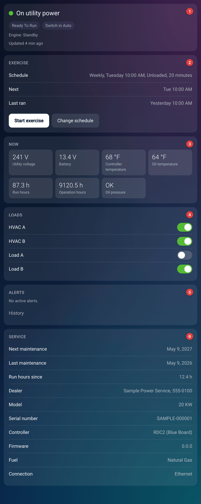

<!-- Copyright 2026 Finite Labs, LLC. All rights reserved. -->

______________________________________________________________________

# Overview

> DISCLAIMER: This software is neither affiliated with nor endorsed by either
> Control4 or KOHLER.

Bring KOHLER home standby generators into Control4. This account driver signs in
to the homeowner's KOHLER account, finds every generator on it, and adds a
companion **Kohler Generator** driver for each one, so each generator appears in
its room in the Control4 app.

# Index

- [System Requirements](#system-requirements)
- [Included Drivers](#included-drivers)
  - [Kohler Generators](#kohler-generators)
  - [Kohler Generator](#kohler-generator)
    - [Generator Page](#generator-page)
- [Compatibility](#compatibility)
- [Installer Setup](#installer-setup)
  <!-- #ifdef DRIVERCENTRAL -->
  - [DriverCentral Cloud Setup](#drivercentral-cloud-setup)
  <!-- #endif -->
  - [Driver Installation](#driver-installation)
  - [Driver Setup](#driver-setup)
    - [Driver Properties](#driver-properties)
      - [Cloud Settings](#cloud-settings)
      - [Account Settings](#account-settings)
      - [Driver Settings](#driver-settings)
      - [Generator Settings](#generator-settings)
    - [Driver Actions](#driver-actions)
  - [Connections](#connections)
  - [Programming Reference](#programming-reference)

<!-- #ifdef DRIVERCENTRAL -->

- [Developer Information](#developer-information)

<!-- #endif -->

- [Support](#support)
- [Changelog](#changelog)

# System Requirements

- Control4 OS 3.3.0 or later
- A KOHLER account with at least one generator set up in the KOHLER Energy
  Management app
- Internet access from the Control4 controller

# Included Drivers

## Kohler Generators

The account driver, and the driver to add first. Enter the KOHLER account's
email and password; it signs in, finds every generator on the account, and
creates a connection for each one. The **Kohler Generator** drivers bind to
those connections, so the account driver is the only place the account is signed
in and the only driver that reaches the KOHLER cloud.

**Key features:**

- Sign-in with the KOHLER account's email and password
- Automatic discovery of every generator on the account
- One companion generator driver per generator, added, bound and named on its
  own after sign-in
- Account Connected and Account Disconnected events for programming
- Generators read on a configurable poll interval

## Kohler Generator

The companion driver. One is added per generator, bound to its connection on the
account driver. It shows the generator in its room and reports whether the
generator is reaching the KOHLER cloud.

**Key features:**

- The generator's status, power source and readings, with its model, serial
  number, firmware, fuel and dealer
- Events, conditionals and contact outputs for outage programming
- Commands to start and stop an exercise, change the exercise schedule and
  switch load-shed loads
- A generator page in the Control4 app

### Generator Page

Selecting a generator in the Control4 app, on a touchscreen or a phone, opens
its page.

1. **Top card** - whether the house is on utility or generator power, the
   engine's state, the switch position and when the generator last reported.
1. **Exercise** - the schedule, the next and last exercise, and buttons to start
   or stop an exercise and change the schedule.
1. **Now** - the readings this generator's controller reports.
1. **Loads** - a switch for each load-shed load, shown only when Load Control is
   On and the generator has a load control module.
1. **Alerts** - active alerts, with the event log under History.
1. **Service** - maintenance dates, the dealer and the generator's details.

The Kohler Generator driver's documentation covers the page in full.

# Compatibility

Any KOHLER home standby generator set up in the KOHLER Energy Management app
works. The driver reads the generator through KOHLER's cloud, so a reading can
be a few minutes old, and a reading the generator's controller does not report
has no value.

# Installer Setup

> ⚠️ Only a **_single_** Kohler Generators driver is required per KOHLER
> account. It adds one **Kohler Generator** driver per generator.

<!-- #ifdef DRIVERCENTRAL -->

## DriverCentral Cloud Setup

> If you already have the
> [DriverCentral Cloud driver](https://drivercentral.io/platforms/control4-drivers/utility/drivercentral-cloud-driver/)
> installed in your project you can continue to
> [Driver Installation](#driver-installation).

This driver relies on the DriverCentral Cloud driver to manage licensing and
automatic updates. If you are new to using DriverCentral you can refer to their
[Cloud Driver](https://help.drivercentral.io/407519-Cloud-Driver) documentation
for setting it up.

<!-- #endif -->

## Driver Installation

<!-- #ifdef DRIVERCENTRAL -->

1. Download the driver from DriverCentral.

1. Extract and
   [install](https://www.control4.com/help/c4/software/cpro/dealer-composer-help/content/composerpro_userguide/adding_drivers_manually.htm)
   all `.c4z` files.

1. Use the "Search" tab to find the "Kohler Generators" driver and add it to
   your project.

1. Select the newly added driver in the "System Design" tab. You will notice
   that the `Cloud Status` reflects the license state. If you have purchased a
   license it will show `License Activated`, otherwise `Trial Running` and
   remaining trial duration. Without an active license or trial the driver stops
   reaching KOHLER five minutes after it loads, its generators go offline and
   [`Driver Status`](#driver-status-read-only) shows `No active license`; it
   starts again as soon as a license is active.

1. You can refresh license status by selecting the "DriverCentral Cloud" driver
   in the "System Design" tab and perform the "Check Drivers" action.
    

<!-- #else -->

1. Download the latest `control4-kohler-generators.zip` from
   [Github](https://github.com/finitelabs/control4-kohler-generators/releases/latest).

1. Extract and
   [install](https://www.control4.com/help/c4/software/cpro/dealer-composer-help/content/composerpro_userguide/adding_drivers_manually.htm)
   all `.c4z` files.

1. Use the "Search" tab to find the "Kohler Generators" driver and add it to
   your project.

<!-- #endif -->

1. Enter the KOHLER account's [`Email`](#email) and [`Password`](#password).

1. After a few moments the [`Login Status`](#login-status-read-only) shows
   `Logged In` and the [`Driver Status`](#driver-status-read-only) shows
   `Connected` with the number of generators found. If it does not, set the
   [`Log Mode`](#log-mode--off--print--log--print-and-log-) property to `Print`,
   run [Reconnect](#reconnect), and check the Lua output window for details.

1. The driver then adds a "Kohler Generator" driver for each generator on the
   account in its own room, binds it, and names it after the generator. A
   generator added to the account later gets its driver the same way.

You can also add the "Kohler Generator" drivers yourself and bind each one to a
generator connection on the "Kohler Generators" driver in the "Connections" tab;
Add Generators then uses any unbound ones in this driver's room before adding
new drivers.

Each companion driver includes its own documentation accessible from within
Composer Pro. Refer to the **Kohler Generator** driver documentation for its
property and programming reference.

## Driver Setup

### Driver Properties

#### Cloud Settings

<!-- #ifdef DRIVERCENTRAL -->

##### Cloud Status (read-only)

Displays the DriverCentral cloud license status.

##### Automatic Updates \[ Off | **_On_** \]

Enables or disables automatic driver updates via DriverCentral. Changing it on
the Kohler Generators driver or any Kohler Generator driver changes it on all of
them.

<!-- #else -->

##### Automatic Updates \[ Off | **_On_** \]

Enables or disables automatic driver updates from GitHub releases.

##### Update Channel \[ **_Production_** | Prerelease \]

Sets the update channel considered during automatic updates from GitHub
releases.

<!-- #endif -->

#### Account Settings

##### Email

The email address the homeowner signs in to the KOHLER Energy Management app
with.

##### Password

The KOHLER account's password. It is hidden in Composer and never written to the
logs.

##### Login Status (read-only)

Displays the sign-in state: `Logged In`, `Logging in...`,
`Enter email and password`, `Invalid email or password`, `Sign-in refused`,
`KOHLER refused access` or `Login failed`. `Sign-in refused` means KOHLER would
not let the account sign in here, most often because the account asks for a
second sign-in step; the driver does not try again until the email or password
changes or you run Reconnect. `KOHLER refused access` means the account signed
in but KOHLER would not let it read the generators. After it, and after
`Login failed`, the driver tries again on its own, waiting longer each time.

#### Driver Settings

##### Driver Status (read-only)

Displays the current status of the driver (`Connected (2 generators)` once
signed in).

##### Driver Version (read-only)

Displays the current version of the driver.

<!-- #ifdef DRIVERCENTRAL -->

##### Log Level \[ 0 - Fatal | 1 - Error | 2 - Warning | **_3 - Info_** | 4 - Debug \]

Sets the logging level. Default is `3 - Info`. While a Support Code has
Composer's Lua tab open, it also offers `5 - Trace` and `6 - Ultra`.

<!-- #else -->

##### Log Level \[ 0 - Fatal | 1 - Error | 2 - Warning | **_3 - Info_** | 4 - Debug | 5 - Trace | 6 - Ultra \]

Sets the logging level. Default is `3 - Info`.

<!-- #endif -->

##### Log Mode \[ **_Off_** | Print | Log | Print and Log \]

Sets the logging mode. Default is `Off`.

<!-- #ifdef DRIVERCENTRAL -->

##### Support Code

Leave it blank unless Finite Labs support gives you a code: for an hour, it
opens Composer's Lua tab to this driver and adds `5 - Trace` and `6 - Ultra` to
Log Level.

##### Cloud Monitoring \[ Disabled | **_Enabled_** \]

When Enabled, the driver sends Finite Labs a short report once an hour, and a
report of each error it hits, at most 10 a minute, so problems in the driver can
be found and fixed. Set it to Disabled to send nothing.

A report holds the controller's MAC address and OS version, the driver's name,
version, device ID and DriverCentral license status, how much memory the driver
uses, and the sizes of its largest internal tables. An error report also holds
the error message and where in the driver it happened. Before a message is sent,
anything in it that looks like a password, token, key, network address or email
address is removed.

<!-- #endif -->

#### Generator Settings

##### Poll Interval \[ 30 seconds | **_60 seconds_** | 120 seconds | 300 seconds | 900 seconds \]

Sets how often the driver reads the account's generators. Default is
`60 seconds`. While a generator's engine runs or its utility power is out, the
driver reads it every 15 seconds instead. It reads each generator's alerts and
event log every 2 minutes, and sooner when its alerts or status change.

### Driver Actions

<!-- #ifndef DRIVERCENTRAL -->

#### Update Drivers

Trigger the driver to update from the latest release on GitHub, regardless of
the current version.

<!-- #endif -->

#### Add Generators

Adds a **Kohler Generator** driver for every generator on the account that
doesn't have one, and binds it. The driver does this on its own after sign-in
and for each generator added to the account later, so run it only to bring back
a Kohler Generator driver you removed. Any Kohler Generator drivers in this
driver's room that aren't bound are used first. Each driver is named after its
generator, and follows it when it is renamed in the KOHLER app unless that
driver's **Auto Rename Driver** property is Off.

A driver whose generator is no longer on the account is renamed with
` - REMOVED FROM KOHLER`; copy any programming from it and delete it. If the
generator comes back to the account, the next Add Generators restores the name.

#### Refresh Generators

Re-reads the account right away, picking up new generators, new names and
changed details.

#### Reconnect

Signs in to KOHLER again with the email and password entered.

#### Reset Driver

> ⚠️ This will reset all connection bindings and delete any programming
> associated with them.

Signs out and removes all generator connections, then signs in again and
rediscovers the account from scratch.

<!-- #ifdef DRIVERCENTRAL -->

It also turns Cloud Monitoring back on, as a fresh install has it.

<!-- #endif -->

**Parameters:**

- **Are You Sure?** \[ **_No_** | Yes \] - Confirmation to reset the driver.

<!-- #ifdef DRIVERCENTRAL -->

#### Diagnostics Snapshot

Prints a report in the Lua output, and sends it to Finite Labs only while Cloud
Monitoring is Enabled.

<!-- #endif -->

## Connections

### `{Generator Name}` (provider, dynamic)

One per generator on the account, created once signed in, with binding class
`KOHLER_GENERATOR`. Bind each to a **Kohler Generator** driver; **Add
Generators** does this for you.

> **Note:** `{Generator Name}` is the generator's name in the KOHLER app.

## Programming Reference

### Variables

| Variable          | Type    | Description                                     |
| ----------------- | ------- | ----------------------------------------------- |
| Account Connected | Boolean | Whether the driver is signed in to the account. |

### Events

| Event                | Description                                                                                                                          |
| -------------------- | ------------------------------------------------------------------------------------------------------------------------------------ |
| Account Connected    | Fires when the driver signs in to the KOHLER account, or signs in again after losing it. Not fired when a reboot finds it as it was. |
| Account Disconnected | Fires when the driver loses its KOHLER sign-in. Use it to send the integrator a notification.                                        |

### Conditionals

| Conditional               | Description                                                  |
| ------------------------- | ------------------------------------------------------------ |
| KOHLER account connection | Tests whether the account is `Connected` or `Not Connected`. |

### Commands

| Command            | Parameters | Description                                         |
| ------------------ | ---------- | --------------------------------------------------- |
| Refresh Generators | None       | Re-reads every generator on the account right away. |

<!-- #ifdef DRIVERCENTRAL -->

# Developer Information

Copyright © 2026 Finite Labs LLC

All information contained herein is, and remains the property of Finite Labs LLC
and its suppliers, if any. The intellectual and technical concepts contained
herein are proprietary to Finite Labs LLC and its suppliers and may be covered
by U.S. and Foreign Patents, patents in process, and are protected by trade
secret or copyright law. Dissemination of this information or reproduction of
this material is strictly forbidden unless prior written permission is obtained
from Finite Labs LLC.

<!-- #endif -->

# Support

<!-- #ifdef DRIVERCENTRAL -->

If you have any questions or issues integrating this driver with Control4, you
can contact us at [%%SUPPORT_EMAIL%%](mailto:__SUPPORT_EMAIL__) or call/text us
at [%%SUPPORT_PHONE%%](tel:__SUPPORT_PHONE__).

<!-- #else -->

If you have any questions or issues integrating this driver with Control4, you
can file an issue on GitHub:

https://github.com/finitelabs/control4-kohler-generators/issues/new

<!-- #endif -->

<!-- #embed-changelog -->
